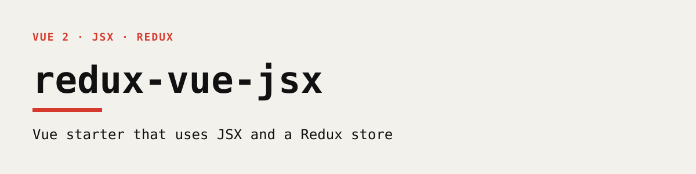

<div align="center">

# redux-vue-jsx-boilerplate



**Vue without templates.** Components are written in JSX, state lives in a Redux store.

`MIT` `Vue 2` `Redux`

</div>

<br>

An old Vue 2 webpack starter. It is a toy-sized template: two components, one Redux store, and the build and test setup from the Vue webpack template. It uses 2016-era tools (webpack 1, Babel 6). `npm install`, `npm run dev`, `npm run lint`, `npm run unit` and `npm run build` work on Node 22 and 24 (checked in CI).

<br>


**1. Get the code and install it:**

```bash
git clone https://github.com/nadimtuhin/redux-vue-jsx-boilerplate.git && cd redux-vue-jsx-boilerplate
npm install
```

**2. Start the dev server:**

```bash
npm run dev
```

Open `http://localhost:8080`. You get the Vue welcome page, built from JSX, with hot reload.

<br>


**JSX instead of templates.** `src/App.js` and `src/components/Hello.js` export components with a `render(h)` function that returns JSX, through [babel-plugin-transform-vue-jsx](https://github.com/vuejs/babel-plugin-transform-vue-jsx).

**Redux instead of Vuex.** `src/store/index.js` creates a Redux store with one `ADD_TODO` action. `src/main.js` plugs it into Vue with [redux-vue](https://github.com/nadimtuhin/redux-vue).

<br>


Everything below is the original reference. You don't need it to get started.

> A Vue.js project

## vue jsx
https://github.com/vuejs/babel-plugin-transform-vue-jsx

## redux vue
https://github.com/nadimtuhin/redux-vue

## Build Setup

``` bash
# install dependencies
npm install

# serve with hot reload at localhost:8080
npm run dev

# build for production with minification
npm run build

# run unit tests
npm run unit

# run e2e tests (needs Java and a Chrome old enough for chromedriver 2.46)
npm run e2e

# run all tests
npm test
```

For detailed explanation on how things work, checkout the [guide](http://vuejs-templates.github.io/webpack/) and [docs for vue-loader](http://vuejs.github.io/vue-loader).
